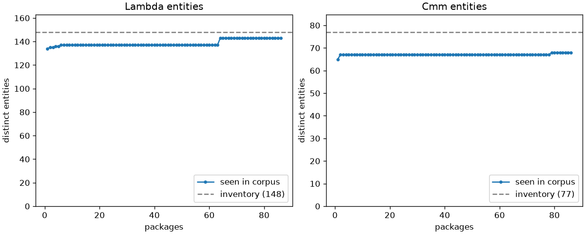

# OCaml IR2Vec: report

IR2Vec-style embeddings for OCaml programs, built from the native compiler's Lambda IR (Symbolic encoding) and Cmm IR (Flow-Aware encoding). Phases 0–8 of `docs/BUILD_SPEC.md`. Every design decision, with its reasoning, is in `DECISIONS.md`, and is cited here as Dx.y.

## 1. Summary, and the boundary of what has been validated

**What exists:**
- **A compiler patch** (about 50 lines) that dumps Lambda and Cmm as OCaml values. Its object files are byte-identical to a stock compiler's.
- **An extractor** that abstracts both IRs into a bounded entity vocabulary, lowering Cmm to three-address code plus a control-flow graph.
- **Seed vocabularies** trained with ComplEx and TransE on 2.7M Lambda and 5.8M Cmm triples from 86 opam packages.
- **Four encoders** (`lambda_sym`, `lambda_fa`, `cmm_sym`, `cmm_fa`) sharing one exact solver.
- **`ir2vec embed`**, which produces 438-dimensional function and module vectors for any `.ml` file or dune project.

**1. Established.** The pipeline is complete, correct and reproducible.
- **Coverage:**
  - 0 unknown entities when encoding the whole corpus.
  - 143 of 148 Lambda and 68 of 77 Cmm entities trained; every untrained possible entity has a documented fallback.
- **Correct solving:** every cyclic component is solved exactly. The max residual is 8.9e-16, with 0 retries and 0 non-finite vectors (§8).
- **Alignment:** 99.85% of Lambda functions aligned with Cmm.
- **Reproducibility:**
  - byte-identical output across runs;
  - a frozen config and vocabularies with provenance hashes;
  - byte-identical figures on regeneration.
- **Well-formed geometry:**
  - No sibling group collapses (§6).
  - Category structure holds at full dimension: an entity's top-1 nearest neighbour is in its own category for **73% of entities, against a 9% chance rate** (ComplEx; TransE 59–61%; §13.1). This is the IR2Vec Figure 6 claim as a number rather than a picture.
  - Where the categories and the geometry disagree, the geometry is organised by operand type and role: conversions sit with the family they produce or consume, as in IR2Vec's Figure 6(d).
  - Rare entities share a region under ComplEx (§10.1, §13.3).
  - The linear-offset (analogy) property does **not** hold in general: 2 of 7 testable quadruples pass (§13.2).

**2. Evidence of signal.** The learned blocks carry program content beyond well-formed structure. Using only the 256 learned dimensions (the count features, which contain CALL_SELF and the arity signature, are excluded), a linear probe recovers:
- **recursion:** AUC 0.97, against 0.81 from function size alone; 0.96 with whole packages held out.
- **arity ≥ 2:** AUC 0.90, against 0.62 from size alone; 0.87 with packages held out.

Neither property is an entity in the learned vocabulary. Both are recovered from IR structure (§13.4). Allocation (0.998) is excluded from this claim: its opcodes are learned entities, so it is decodable by construction.

**3. Not established.** **No downstream task has been run.** Nothing here shows that the embeddings are *useful* for any prediction task.
- The quality checks (distinctness, nearest neighbours, held-out link prediction, analogies) measure geometry and fit.
- The probes measure **linear decodability**, not usefulness.
- An AUC of 0.97 invites over-reading. The Phase 7 boundary stands unchanged: usefulness is untested until a downstream task is scored.

## 2. Pinned toolchain

| Component | Version |
|---|---|
| OCaml | **5.5.1** (tag `5.5.1`, commit `46e1c32`), native, non-flambda, `tsan: false` |
| Patched switch | `ir2vec`: `ocaml-variants.5.5.1+ir2vec`, pinned as the **switch invariant** (D4.11) |
| Compiler patch | `compiler-patch/ir2vec-hooks.patch`, revision 3 (dump format 2, D5.13) |
| opam / dune / ocamlfind | 2.5.0 / 3.24.2 / 1.9.9~preview |
| Python / torch | 3.14.4 / 2.14.0+cpu (venv `~/ir2vec-venv`) |
| Host | WSL2 Ubuntu 26.04, x86_64, on Windows 11 |

## 3. Corpus

- **Packages:** 87 listed in `corpus/packages.txt`; **86 built**, with **0 extraction failures**.
  - The pinned compiler's own `ocaml-stdlib` is included (D3.12). It's the only place the effect, atomic and domain-local primitives occur.
  - The rest: 29 general-purpose packages, 7 OCaml 5 concurrency packages, and 50 more added to dilute dune (D4.4).
- **Failed:** `notty` needs `ocaml < 5.4`. Under the switch invariant it fails cleanly at the dependency step (`failed-deps`) instead of replacing the compiler; see §9.
- **Excluded:** `corpus/exclude.txt` (future evaluation benchmarks) is empty.
- **Size:** 2,495 units per level before the cap, 1,829 after. In the selection: 63,363 Lambda functions, 70,843 Cmm functions, 1,354,099 Cmm operations.
- **Cap (D4.4):** no package may contribute more than **15%** of the selected units. The per-package allowance is solved exactly (274 units), and the sample is deterministic (smallest SHA-256 of the unit name). **Only dune binds: 940 → 274 units, exactly 15.0%.** No entity lost coverage, so there were 0 coverage exemptions. The next largest shares are menhir 12.7%, base 8.4%, ppxlib 6.7% and owl-base 6.4%.
- **Extern whitelist (D3.5, D4.3):** one list shared by both levels, exactly 64 names, plus `EXT_OTHER`.
  - 16 are **pinned**, each with a reason in the config: `caml_atomic_*` (4 names), `caml_modify`, `caml_compare`, `caml_equal`, `caml_string_compare`, `caml_string_equal`, and GC/allocation runtime names. All 16 occur in the corpus, so there are no always-zero pinned dimensions today.
  - The other 48 are ranked by **the number of packages using the name** (raw count breaks ties), and each must appear in **at least 3 packages**. That removed package-private C stubs such as dune's `lev_*`.
- **Dead code** (D2.8): 287 dead Cmm operations out of 1,354,099 (**0.021%**) on the capped corpus (0.023% on the earlier 37-package corpus). A small number is expected from genuinely unreachable code after a raise or exit. A large one would signal a lowering bug, so it stays in the report as a regression signal.
- **Provenance:** the corpus dumps are **format 1** (hooks revision 2) and predate the build-hash header; see §10.2.

## 4. Entities versus the schema

| | Lambda | Cmm |
|---|---|---|
| Schema (§3) | 151 | 78 |
| Inventory on 5.5.1 (`docs/entities.5.5.1.json`, generated from the compiler's `.mli`) | **148** | **77** |
| Trained entities (at least 1 training triple) | **143** | **68** |
| Vectors after merges (trained vocabulary) | **127** | **66** |
| Merged away (rare families) | 20 | 7 |
| Fallback-mapped (possible, untrained; lookup only) | 4 | 5 |
| Impossible on this compiler path (hard error) | 1 (`Psetglobal`) | 1 (`RETURN_ADDR`) |
| Count features | 95 | 83 |

**Differences from the schema, all recorded:**
- `Pphyscomp`, `Pcheckbound`, `Patomic_fetch_add` and `Catomic_fetch_add` don't exist in 5.5.1 (D0.15). If the pin moves to 5.6, the exhaustive matches fail the build until they're re-added.
- `Cload.is_atomic` was a schema omission. It's the count feature `LOAD_ATOMIC`/`LOAD_NONATOMIC`, making Cmm count features 81 + 2 = 83 (D0.16).
- Lambda gets an 8-dimension signature block (own arity, own return kind), making 87 + 8 = 95 (D1.12).
- **Merges:** Lambda `P_RAW_LOAD`, `P_RAW_STORE`, `P_BIGARRAY`, `P_BSWAP`; Cmm `C_RUNTIME`, `Cstore_narrow`. `Cload_narrow` doesn't merge because `Cload_32s` has 1,156 triples, and `P_ATOMIC` would have had a single member (D3.2).
- **Fallbacks (D4.2):**
  - Lambda: `Ppoll → Pccall`, `Pduprecord → Pduparray`, `Pint_as_pointer → Popaque`, `Psetfloatfield → Psetfield`.
  - Cmm: `Cload_single → Cload_double`, `Cstore_single → Cstore_double`, `Cload_byte_s → Cload_byte_u`, `Cload_16s → Cload_16u`, `TUPLE → COPY`.
- **Impossibility is verified against the 5.5.1 source (D4.1).**
  - Native closure mode never emits `Psetglobal`, and `Creturn_addr` only comes from ThreadSanitizer instrumentation. A test asserts `flambda = false` and `tsan = false`, the preconditions for both claims.
  - `Ppoll`/`Cpoll` are *possible*, through `Sys.poll_actions` (`%poll`).
- **Low confidence:** 51 Lambda vectors and 12 Cmm vectors are trained on fewer than 1,000 triples (`report/entities.tsv`).
  - This includes the **effect primitives** `Pperform` (16), `Presume` (20), `Prunstack` (12) and `Preperform` (12), plus `Patomic_load` (8), `Pdls_get` (4), `C_RUNTIME` (7) and `Cstore_byte_s` (4), and most boxed-integer and float-conversion operations.
  - The effect primitives are deliberately never merged (D4.5).
- **Distinct triples are few:** 3,928 distinct among 2,690,094 Lambda triples, and 1,189 distinct among 5,799,815 Cmm triples. The schema bounds the vocabulary, so the graph's *structure* is small and fixed. Further corpus growth adds frequency, not structure, and is only worth doing to cover missing entities.

**Plateau** (`report/plateau.png`, `report/plateau.csv`): the cumulative count of distinct entities against the number of packages is flat and stays below the inventory, with 0 unknown entities. No abstraction rule leaks unbounded payloads into entity names; the remaining gap is coverage.



## 5. Training

Both models use dim 128 (ComplEx: rank 64, with the entity vector being `concat(real, imag)`), Adam, 4 negatives per positive, and seed 20260925. A small PyTorch trainer is used because PyKEEN deduplicates triples (D4.6).
- **Sampling:** distinct triples are drawn with probability ∝ count^α, with **α = 0.75** (D5.1).
- **Stopping:** at the loss plateau (at most 60 epochs as a safety net), never on held-out metrics (D5.2).

**α = 1.0 vs 0.75.** Each run stopped on the loss plateau at 16–40 epochs.

| ComplEx | α = 1.0 | α = 0.75 (chosen) |
|---|---|---|
| Distinctness, types (Lambda / Cmm) | 0.826 / 0.966 | 0.645 / 0.847 |
| Distinctness, operand kinds (Lambda / Cmm) | 0.688 / 0.909 | 0.633 / 0.811 |
| Groups flagged below 0.1 | none | none |
| Low-confidence cohesion (Lambda / Cmm; higher is less collapsed) | 0.516 / 0.344 | **0.690 / 0.469** |
| Common clusters (e.g. `Paddint ~ Psubint`, `BR ~ SWITCH`) | rank 1–2 | rank 1–2 |

Distinctness is a collapse check, and both settings pass it. Nearest-neighbour sanity therefore decides, and it favours α = 0.75: less rare-entity collapse, every common cluster kept, and for example `Cstore_byte_s` gains its own family (`Cstore_narrow`) as a neighbour. Both settings are kept under `vocab/exp/`.

**Held-out metrics (for the record only).** Filtered, on the distinct triples of a 5% held-out occurrence split. "Novel" means distinct held-out triples never seen in training.

| Level | Model | Epochs | MRR | hits@1 | hits@10 | Novel MRR | Novel hits@10 |
|---|---|---|---|---|---|---|---|
| Lambda | ComplEx | 36 | 0.957 | 0.940 | 0.990 | 0.277 | 0.542 (n = 24) |
| Lambda | TransE | 40 | 0.857 | 0.736 | 0.994 | 0.219 | 0.583 (n = 24) |
| Cmm | ComplEx | 16 | 0.970 | 0.954 | 0.997 | 0.265 | 0.667 (n = 6) |
| Cmm | TransE | 18 | 0.914 | 0.836 | 0.998 | 0.407 | 0.833 (n = 6) |

With a few thousand distinct triples, these numbers measure memorisation, and the novel subsets are too small to carry weight. **They are not used to compare models.** ComplEx is primary on geometry (§6); TransE is trained and shipped as the baseline. The nearest-neighbour reports are `report/nn_<level>_<model>.txt`.

## 6. Distinctness (schema §4)

The score is the mean within-group cosine distance ÷ the mean cosine distance over all entity pairs, and a group is flagged below 0.1. Source: `report/distinctness.md`, produced by `ir2vec check distinctness`.

| Level | Group | ComplEx | TransE |
|---|---|---|---|
| Lambda | types | 0.645 | 0.802 |
| Lambda | operand kinds | 0.633 | 0.754 |
| Lambda | `Lapply_a*` | 0.516 | 0.555 |
| Lambda | `Lfunction_a*` | 0.341 | 0.731 |
| Lambda | `Pgetglobal_*` | 0.262 | 0.726 |
| Cmm | types | 0.847 | 0.896 |
| Cmm | operand kinds | 0.811 | 0.830 |
| Cmm | `Cload_*` | 0.632 | 0.913 |
| Cmm | `Cstore_*` | 0.405 | 0.924 |

**No group is flagged.** ComplEx places siblings closer together than TransE while still separating them. That's consistent with its tighter semantic clusters (`Paddint ~ Psubint` at cosine 0.84, `Caddf ~ Csubf` at 0.92).

## 7. Alignment (Lambda ↔ Cmm)

Source: `report/alignment.{json,tsv}`, produced by `ir2vec check alignment` over the selected corpus.

| | Count |
|---|---|
| Lambda functions | 63,363 |
| **Matched** | **63,265 (99.85%)** |
| … by `entry` / stamp / location / parameter stamps | 1,829 / 43,794 / 15,455 / 2,187 |
| Lambda-only: named / anonymous / `module_init` | 9 / 89 / 0 |
| Cmm-only: synthesised closures / optional-argument inner / other | 6,219 / 1,359 / **0** |

- **Independent cross-check of the fragile path:** for all 43,794 stamp matches and all 15,455 location matches, the Lambda parameter stamps (a signal the match didn't use) are included in the Cmm ones. There are **0 disagreements**.
- **Parent links on Cmm-only rows (D7.1):** 6,576 (86.8%) have a Lambda `parent_fid`, 279 have only a `parent_cmm`, and 723 have neither (no unique referrer, e.g. a static closure). Rows are never folded; that's the consumer's choice.
- **Module vectors sum *all* rows**, including the 7,578 Cmm-only functions (D6.8). A module's cells therefore equal the sum of *all* of its rows (aligned, Lambda-only and Cmm-only), **not** the sum of its aligned rows. And a module's `final` is not the sum of its rows' `final`s, because the L2 and log1p transforms apply after summing. This is intended, not a bug.
- **Symbol names are conventions, not APIs.** Alignment depends on 5.5.1's `caml<Unit>.<name>_<stamp>` names, `.entry` (the spec said `__entry`), `fun_<N>` and `<name>_inner_<N>`. Recheck them on any version bump (D6.9).

## 8. Inference checks

**Corpus encode** (`ir2vec check encode`, `report/encode_check.{complex,transe}.json`) runs all four cells over every selected unit.

| | ComplEx | TransE |
|---|---|---|
| Units / Lambda functions / Cmm functions | 1,829 / 63,363 / 70,843 | same |
| **Unknown-entity lookups** | **0** | **0** |
| Fallback lookups | 0 | 0 |
| Impossible entities | 0 | 0 |
| Cyclic components solved (largest) | 2,078 (114) | 2,078 (114) |
| Max solver residual | 8.9e-16 | 2.2e-16 |
| Ill-conditioned retries | 0 | 0 |
| Non-finite vectors | 0 | 0 |

The solver is exact to machine precision; nothing is rounded (D5.5). No fallback is used on the corpus, as expected, because fallback entities are by definition absent from it. They exist for new programs.

**`embed` acceptance (Phase 6).**
- `tests/fixtures/align.ml`: 4 functions plus `module_init`, all aligned (the anonymous function by location), 0 unknown lookups.
- A fresh file outside the corpus: every function aligned, 0 unknown lookups.
- A dune project depending on `re` (`tests/embed_project`, built with `--install-deps`): 2 units, 14/14 functions aligned, 0 unknown lookups.
- Output dimensions are asserted: `final` = L2(`lambda_sym`) 128 + L2(`cmm_fa`) 128 + log1p(counts) 95 + 83 + log1p(node counts) 4 = **438**.

**Tests:** `dune test` (extractor, goldens, inventory, exhaustiveness mutations, lowering invariants, dump provenance) and `pytest` (94 tests, 15 of them Phase 8) pass. `extractor/test/stress_testsuite.sh` (manual) extracts 218 OCaml testsuite programs with 0 invariant violations.

## 9. Incidents and defects found

These are recorded because both kinds recur.

1. **opam silently replaced the patched compiler (D4.11).** `notty` requires `ocaml < 5.4`, and `opam install --deps-only -y` accepted the solver's plan to remove the pinned `ocaml-variants.5.5.1+ir2vec` and install stock 5.3.0. The next 10 packages built without hooks and produced no dumps. That looked identical to packages with no units.
   - **Fixes:**
     - The patched compiler is now the switch invariant. (The first attempt used the wrong `set-invariant` form; opam 2.5 needs `--packages=`.)
     - `build_corpus.sh` checks the compiler before the run and after every step, and compiles a **canary** that the strict reader must accept.
     - Dumps now carry the compiler's build hash (§10.2).
   - Nothing was contaminated: the stock compiler writes no dumps, and the reader rejects other versions.
2. **`Config.bindir` is the empty string in 5.5's relocatable install (D5.13).** The first build-hash check looked for the compiler at `Config.bindir/ocamlopt.opt` and failed. The expected hash is now generated when the extractor is built, from the `%{ocamlopt}` dune uses, so rebuilding the compiler regenerates it.

**Other defects found and fixed:**
- **`-pack` units have no source** (D3.13). Dumping them failed, which broke `ocamlbuild`. They are now skipped with a notice.
- **5.5.1's `Cmm.map_shallow` skips `Cswitch` scrutinees** (D2.9), which undercounted operations in two tools. The stress test caught it.
- **A leftover install was rebuilt into the wrong package's dumps** (D3.4). Reverse dependencies are now removed before a rebuild.
- **Parallel assignment at `Cexit`** and **aliasing of mutable variables** in the lowering (D2.5, D2.6).

## 10. Known limitations

### 10.1 Rare entities share a region of the embedding space

Entities with very few training triples end up near *each other*, not near their semantic relatives. They include the effect primitives (`Pperform` 16 triples, `Presume` 20, `Prunstack` 12, `Preperform` 12), `Patomic_load` (8), `Pdls_get` (4), `C_RUNTIME` (7) and `Cstore_byte_s` (4). Under ComplEx, most of them have only other low-confidence entities among their 5 nearest neighbours.

- **Not under-training.** The displacement from initialisation, ‖final − initial‖ / ‖initial‖, is about the same for low-confidence and other entities: ComplEx 4.51 vs 4.69, and TransE 0.71 vs 0.84, both at α = 1.0. Rare entities move substantially; they move into a *shared* region.
- **Mechanism:** uniform negative sampling. An entity that rarely appears as a true head or tail appears constantly as a corrupted one, so every such entity gets the same push.
- **Mitigation applied:** frequency smoothing with α = 0.75 (D5.1). It raised the low-confidence cohesion ratio (mean distance among them ÷ all pairs) from 0.52 to 0.69 (Lambda) and from 0.34 to 0.47 (Cmm), with no loss on the common clusters.
- **Why this isn't collapse:** no sibling group falls below the 0.1 distinctness flag. Some of the proximity may even be genuine, since `Pdls_get`, `Patomic_load` and the effect primitives do co-occur in unusual, low-level code.
- **See it:** the rarity control panels (`report/figures/seeds_<level>_<model>_rarity`) colour every entity by training frequency, ignoring category; §13.3 quantifies the region with nearest-neighbour counts (ComplEx: 86% of low-confidence Lambda entities have a low-confidence nearest neighbour, against a 40% base rate; TransE: 43%).
- **Next step, once a downstream task exists to score it:** type-constrained negative sampling (corrupt only with entities of the same kind: opcode, type or operand kind).

### 10.2 The corpus predates dump provenance revision 3

The corpus dumps are format 1 (hooks revision 2). They carry the OCaml version but not the hooks revision or the compiler's build hash (D5.13).

- **Guaranteed:** every dump was written by a patched 5.5.1 compiler. A stock compiler writes none, and the reader rejects any other version. The object files of the patched compiler were verified identical to stock after every switch rebuild (`check_objects.sh`). The corpus build also checked the compiler before and after every package, from D4.11 onwards.
- **Not guaranteed:** which *build* of the patched compiler wrote a given dump. The switch was rebuilt several times during Phase 3 (D3.13, D4.11). Every rebuild was from the same source and patch, but that's asserted by process, not by hash.
- **How it's read:** the format-1 dumps are readable only with `--legacy-format-1`, which is tested. The extracted JSON, which is what training used, is unaffected.
- **Plan:** re-dump under revision 3 at the next full corpus rebuild.

### 10.3 Other limitations

- **No downstream evaluation** (§1). Every choice made by evidence (α, ComplEx as primary) used intrinsic signals only.
- **Held-out link prediction mostly measures memorisation** (§5).
- **Untrained possible entities use fallback vectors.** Four Lambda and five Cmm entities (§4) will appear in some user programs, for example with Bigarray `float32`, `int16_signed` or explicit polls. They get a documented stand-in vector, which is counted and reported.
- **Schema §4's tail-call folding experiment was not run** (D7.4). Tail position stays a count feature.
- **Everything is tied to the pinned compiler.** The entity inventory, the symbol-naming conventions and the stamps are properties of 5.5.1 (D6.9). A version bump needs the inventory regenerated (the build fails on constructor changes by design), the goldens promoted, and the alignment conventions rechecked.
- **`count_synthetic` defaults to false,** so the COPYs added by the lowering are excluded from triples and sums. This is ablatable, but no ablation has been run, and neither has the callee-node inclusion ablation (D1.4).

## 11. Reproducing

```sh
compiler-patch/make_switch.sh --stock       # patched switch (invariant) + stock switch
compiler-patch/check_objects.sh             # object files identical to stock
corpus/build_corpus.sh                      # 87 packages (+ ocaml-stdlib), canary-checked
ir2vec select && ir2vec stats && ir2vec freeze-config
ir2vec triples --level lambda && ir2vec triples --level cmm
ir2vec train --level lambda --model complex # and transe; and --level cmm
ir2vec check plateau && ir2vec check entities && ir2vec check alignment
ir2vec check distinctness --vocab vocab/*.complex.json vocab/*.transe.json
ir2vec check encode                         # corpus-scale inference check
ir2vec embed path/to/program.ml             # or a dune project directory
ir2vec figures all                          # Phase 8 figures (report/figures/)
opam exec --switch=ir2vec -- dune test && (cd python && python -m pytest)
```

## 12. Figures (Phase 8)

All figures are in `report/figures/`, each as PNG + SVG with a `.tsv` of the plotted numbers. Regenerate them with `ir2vec figures all` (D8.8). `MANIFEST.tsv` records the matplotlib/numpy versions and every file's sha256. The SVGs are byte-identical on regeneration in that environment (D8.3).

**Rules that hold in every figure (D8.1, D8.2):**
- Projections print their explained variance.
- Groups carry their full-dimensional distinctness d. No similarity claim is read off a 2-D position.
- Low-confidence vectors (< 1,000 triples) are hollow.
- Fallback-mapped and impossible entities (4 + 1 Lambda, 5 + 1 Cmm) are never plotted. They are listed in each .tsv with their fallback target, and the caption states the counts.
- Captions carry model, α, the vocabulary hash, and the category-map asymmetries:
  - `Praise` is a control form, but `Craise` is runtime.
  - the merged `P_RAW_LOAD`/`P_RAW_STORE` span strings, bytes and bigstrings.
  - `Cload_narrow` is unused.

| Figure | Files | What it shows |
|---|---|---|
| §8.1 Seed scatter | `seeds_<level>_<model>_<panel>` | 7 Lambda / 6 Cmm comparison panels (per-panel PCA), an all-entities facet grid, and the **rarity control panel** (`…_rarity`: colour = log10 training triples, ignoring category) |
| §8.2 Cosine heatmap | `heatmap_<level>_<model>` | full-dimensional cosine matrix, category-ordered with boundaries |
| §8.3 Distinctness | `distinctness_models`, `distinctness_alpha` | Report §6 and the D5.1 α comparison, plotted; values identical (tested) |
| §8.4 Neighbours | `neighbours_<level>_<model>` | top-3 neighbours of every entity, sectioned by category |
| §8.5 Analogy | `analogy` | offset consistency against a 10,000-draw random-pair null |
| §8.6 Functions | `functions_<model>` | PCA of 61,436 corpus functions, **learned 256 dimensions only** |
| §8.7 Probe | `probe` | linear decodability of four IR properties from the 256 learned dimensions |

## 13. What the geometry shows

Negative results are stated as they came out. ComplEx is primary; TransE is given where it differs.

### 13.1 Which clusters hold

- **Category structure is real at full dimension.** The mean within-category cosine exceeds the mean between-category cosine for every vocabulary:

  | vocabulary | within-category | between-category |
  |---|---|---|
  | Lambda ComplEx | 0.478 | 0.297 |
  | Cmm ComplEx | 0.557 | 0.308 |
  | Lambda TransE | 0.154 | −0.010 |
  | Cmm TransE | 0.158 | −0.008 |

  ComplEx vectors share a positive common direction (between-category mean ≈ 0.3), so ComplEx cosines should be read relative to 0.3, not 0. TransE is centred.
- **Nearest neighbours agree with the categories far above chance.** The top-1 neighbour is in the same category for:
  - ComplEx: 73.2% of Lambda entities (chance 8.5%) and 72.7% of Cmm (chance 9.5%).
  - TransE: 59.1% and 60.6%.
- **Clusters that hold completely under ComplEx (top-1 same category):**
  - float arithmetic 6/6 at both levels.
  - Cmm int arithmetic 12/12.
  - Lambda comparisons and tests 11/11.
  - operand kinds 10/10 at both levels.
  - boxed-int 11/12.
  - strings and bytes 11/12.
  - Cmm loads 7/8.
  - control forms 19/23.
  - The array get/set variants pair up with their unsafe/safe twins (`Parrayrefs`↔`Parrayrefu`, `Parraysets`↔`Parraysetu`).
- **Clusters that do not hold. The neighbours follow operand type or role instead:**
  - **Conversions** (Lambda 1/5, Cmm 0/2) sit with the family whose values they consume or produce: `Pfloatofint`, `Cfloatofint` and `Cintoffloat` with float arithmetic; `Pbintofint`, `Pcvtbint` and `Pintofbint` with boxed-int. There is no conversion cluster.
  - **Blocks and records (0/8)** scatter by use:
    - `Pfloatfield` sits with float arithmetic.
    - `Psetfield_computed` sits with array/bytes sets.
    - `Psetfield` sits with `Lsequence`/`Lstaticcatch`, i.e. imperative code.
    - `Pmakeblock` sits with `Pmakearray` and `Lapply_a*`.
  - **Cmm comparisons (0/3)** split by operand type: `Ccmpf` with float ops, `Ccmpi` with int ops.
  - **`Craise`** sits with `RET`/`JUMP`/`SWITCH`, i.e. it behaves as a terminator. This supports putting `Praise` in control forms and `Craise` in runtime.
  - **Pointer arithmetic (0/2)** sits with `Cload_word_val`.
  - **Arrays (3/8)**, runtime intrinsics (0/2) and misc (0/3) do not form clusters. Their rare members are in the rare-entity region (§13.3).

  The categories were chosen for display (D8.0). Where they disagree with the geometry, the geometry is organised by operand type and position in code, which is what the triples encode.

  - **This is a finding, not a defect in the map.** The conversions result is IR2Vec's Figure 6(d) finding, reproduced independently. Because conversions were given their own category first, the geometry showed this rather than our assuming it.
  - **The categories are deliberately not revised to match.** The divergence is the result.

### 13.2 The analogy test, against the null

Each quadruple (a, b) vs (c, d) scores cos(b − a, d − c). The score is placed in a null of 10,000 random quadruples of distinct entities from the same vocabulary. The decision rule was fixed before looking (D8.5): the Bonferroni-corrected percentile 100·(1 − 0.05/k).

- **Null distribution:** mean ≈ 0 in every vocabulary; std 0.190 (Lambda ComplEx), 0.214 (Cmm ComplEx), 0.119 (Lambda TransE), 0.131 (Cmm TransE).

| quadruple | ComplEx cos (random-null pct · matched-null pct) | TransE cos (random-null pct · matched-null pct) | verdict (both models) |
|---|---|---|---|
| (Paddint, Psubint) vs (Paddfloat, Psubfloat) | +0.046 (61.0 · 58.4) | +0.002 (50.9 · 50.5) | **does not hold** |
| (Paddint, Paddbint) vs (Psubint, Psubbint) | +0.857 (100.0 · 100.0) | +0.438 (100.0 · 99.3) | **holds** |
| (Parrayrefu, Parraysetu) vs (Parrayrefs, Parraysets) | +0.702 (100.0 · 99.9) | +0.307 (99.4 · 99.5) | **holds** |
| (Pstringrefu, Pbytesrefu) vs (Pstringlength, Pbyteslength) | +0.026 (56.3 · 53.1) | +0.118 (84.3 · 84.9) | **does not hold** |
| (Lapply_a1, Lapply_a2) vs (Lfunction_a1, Lfunction_a2) | −0.016 (47.5 · 46.4) | +0.045 (65.5 · 63.5) | **does not hold** |
| (Caddi, Csubi) vs (Caddf, Csubf) | +0.080 (65.6 · 67.3) | −0.112 (18.6 · 7.9) | **does not hold** |
| (Cload_word_val, Cstore_word_val) vs (Cload_double, Cstore_double) | +0.297 (91.6 · 56.0) | +0.120 (82.3 · 82.8) | **does not hold** |
| (Cload_byte_u, Cload_byte_s) vs (Cload_16u, Cload_16s) | – | – | **untestable**: both `_s` loads are fallback-mapped (no own vector) |

**How to read the two percentiles.**
- **The verdict** comes from the random-null percentile alone. It answers "is this offset non-random?" against the pre-registered Bonferroni rule (D8.5).
- **The matched-null percentile** is a required diagnostic, not a gate. It answers "is it more than category membership?" Read it the same way every time:
  - **≥ 95:** the offset is more than the two pairs sharing categories.
  - **< 95 with a high random-null percentile:** the random-null result is explained by category membership alone.

**Verdict: the linear-offset property does not hold in general.**
- **Where it holds:** 2 of 5 Lambda quadruples and 0 of 2 testable Cmm quadruples, identically under both models.
- **The two that hold** encode a *type* change (int → boxed-int) and a *checking* change (unsafe → safe array access).
- **They are not a cluster artefact.** Two pairs that merely link the same two clusters would also give a high cosine. So each quadruple was also placed against a category-matched null, drawing each position from its tested entity's own category (D8.5). The two passing quadruples sit at its 100.0th/99.3rd (int → boxed-int) and 99.9th/99.5th (array) percentiles.
- **The load → store quadruple is.** It scores 91.6th against the random null but 56.0th against the matched null: category membership alone explains it.
- **Which relations fail:** the *operation* offsets (add → sub across int and float, arity 1 → 2 across apply and function, string → bytes across get and length). Those offsets are not consistent directions in the space.
- **Interpretation (not tested further).** The two passes are *representation* relations: int → boxed-int and unsafe → safe access, where two families differ by a systematic property of their operands or checks. That property shows up in their triples (types, operand kinds, neighbouring nodes). The failures are *operation* relations: add → sub would need the embedding to separate operations that occur in near-identical contexts, and nothing in the triple structure distinguishes them. On this reading, more data of the same kind would not make the property hold; a different signal would.

### 13.3 The rare-entity region (limitation 10.1)

The rarity control panels (`seeds_<level>_<model>_rarity`) show it directly: low-confidence entities occupy a shared region of the projection, whatever their category.

Nearest-neighbour counts make it quantitative:

| vocabulary | low-confidence entities whose top-1 neighbour is also low-confidence | share of all entities that are low-confidence |
|---|---|---|
| Lambda ComplEx | 44 / 51 (86%) | 40% |
| Cmm ComplEx | 11 / 12 (92%) | 18% |
| Lambda TransE | 22 / 51 (43%) | 40% |
| Cmm TransE | 6 / 12 (50%) | 18% |

- **The effect is strongly ComplEx-specific.** TransE is near its base rate for Lambda.
- **Category agreement is lower for rare entities:** ComplEx top-1 same-category is 80% for confident Lambda entities (61/76) vs 63% for low-confidence ones (32/51).
- **Some clusters are partly the rarity effect.** The low-confidence members of boxed-int, `Pcompare_*` and the effects/runtime-intrinsics group are neighbours of each other *and* rare. For these groups the category cluster and the rarity cluster cannot be separated with this data.

### 13.4 Function-level geometry and linear decodability

- **Setup:**
  - 61,436 aligned functions from 1,829 units. 7,676 unaligned rows are excluded.
  - 1,829 module_init rows are also excluded. They are top-level initialisation code, not functions anyone wrote: `Pgetglobal_self` + `Lsequence` + `Psetfield` make up 52% of their Lambda nodes. Including them would pull the PCA toward that structure (D8.6).
  - Projected on the 256 learned dimensions only, L2(lambda_sym) ⊕ L2(cmm_fa).
  - The count features are excluded because they contain CALL_SELF, ALLOC and the arity signature, which would guarantee separation.
- **Probe:** logistic regression with 5-fold CV (D8.7). AUC as mean ± std:

| property (positives / 61,436) | ComplEx AUC | TransE AUC | package-grouped folds (C / T) | size only | shuffled labels |
|---|---|---|---|---|---|
| recursive (3,831) | 0.972 ± 0.004 | 0.969 ± 0.004 | 0.963 / 0.959 | 0.813 | 0.49 |
| allocating (30,934) | 0.998 ± 0.000 | 0.998 ± 0.000 | 0.997 / 0.997 | 0.691 | 0.50 |
| arity ≥ 2 (30,663) | 0.897 ± 0.003 | 0.899 ± 0.003 | 0.867 / 0.869 | 0.618 | 0.50 |
| uses effects (18) | 0.986 ± 0.028 | 0.997 ± 0.005 | 0.884 / 0.873 (3 of 5 folds usable) | 0.408 | 0.52 |

- **Majority-class accuracy vs probe accuracy:**
  - recursive: 0.938 vs 0.965.
  - allocating: 0.504 vs 0.982.
  - arity: 0.501 vs 0.817.
  - effects: 1.000 vs 1.000. At a 0.5 threshold, accuracy says nothing for effects; only AUC does.

- **Recursion and arity are linearly decodable, well beyond size.** Neither is an entity in the learned vocabulary, and both survive package-grouped folds, so this is not leakage of near-duplicate code across folds. This is the strongest evidence here that the learned blocks carry structure beyond opcode counts.
  - Recursion: 0.97 vs 0.81 from log node count alone.
  - Arity ≥ 2: 0.90 vs 0.62.
- **Allocation (0.998) is expected by construction.** `Pmakeblock`, `Pmakearray` and `Calloc` are learned entities whose vectors are summed into the function vector. It shows the encoders preserve their inputs, not that they learned anything.
- **Effects: too few positives to conclude anything.** 18 functions, all in a few packages. The package-grouped estimate is 0.87–0.88 from 3 usable folds, and the effect primitives are learned entities.
- **The 2-D projections show the same thing only weakly.** Recursive functions are tighter than average (d = 0.35 ComplEx, 0.52 TransE), while arity classes are not (d ≈ 0.7–1.1). The first two PCs explain 36% of the variance. As intended, no claim rests on the scatter.
- **Package** colouring shows overlapping clouds (d 0.80–1.21) and is not probed (D8.7).
- **Caveat:** linear decodability of IR properties is **not** usefulness for any downstream task. §1's boundary is unchanged.
